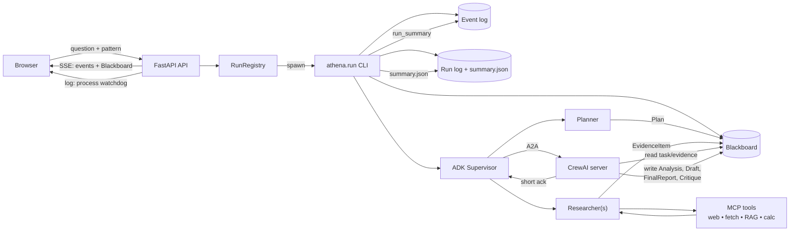
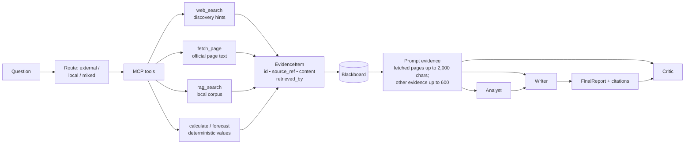
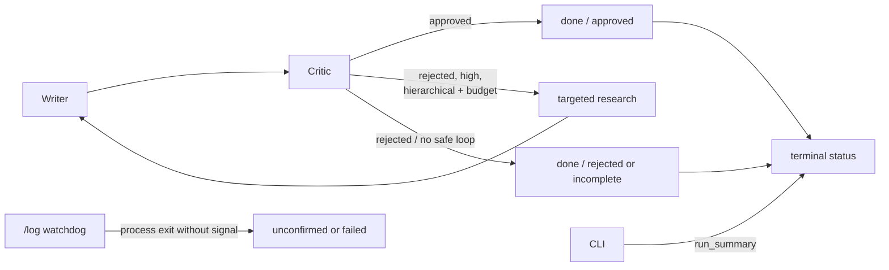

# Athena Run Flow

One-page view of a live run: **what runs, where data goes, and what each store
owns.**

- **Blackboard** = research content and provenance.
- **Event log** = timeline, metrics, and terminal summary.
- **Browser** = a read-only view of those stores.

**Presentation deck:** [HTML](athena-flow.html) · [PDF](Athena-Flow.pdf)

The four-page HTML/PDF deck is the compact visual version for reports and
presentations. The Mermaid blocks below remain the source-friendly version.

---

## 1. One run at a glance

The browser never calls a tool or the provider directly. The API only starts
the CLI and reads the stores.

---

## 2. What goes where

| Data | Written by | Stored in | Read by |
|---|---|---|---|
| Question, pattern | Browser → API → CLI | Blackboard `task` | Planner, all roles |
| Plan | Planner | Blackboard `plan` | Supervisor, writer |
| Tool result | MCP servers | Converted to `EvidenceItem` | Analyst, writer, critic |
| Evidence | Researchers | Blackboard `evidence` | Prompts, gate, UI |
| Analysis | CrewAI analyst | Blackboard `analysis` | Writer |
| Draft / final report | CrewAI writer | Blackboard `draft`, `final_report` | Critic, UI |
| Critique | CrewAI critic | Blackboard `critique` | Supervisor, summary |
| Events / metrics | Recorder + hooks | Event log | SSE, metrics, heatmap |
| `RunSummary` | CLI | Event log + `.summary.json` | SSE done, history |
| Process output | CLI | `.run/runs/{id}.log` | `/log` watchdog |

A2A carries only `run_id`, role, and a short instruction; the CrewAI role reads
and writes the Blackboard itself. The `p2p` pattern is the exception: it carries
stage context inline in the A2A message.

---

## 3. Evidence path

**Non-negotiable rules**

- A snippet is a hint, not a fetched claim.
- Failed or empty fetches are audit-only and never citable.
- Full evidence stays on the Blackboard even when prompt rendering is bounded.
- Fetched web content is untrusted external data.
- Missing evidence produces a gap, not a fabricated finding.

---

## 4. Patterns

```mermaid
flowchart TB
    subgraph SEQ["sequential"]
        S1["planner"] --> S2["one researcher<br/>all tools"] --> S3["analyst"] --> S4["writer"] --> S5["critic"]
    end

    subgraph PAR["parallel"]
        P1["planner"] --> P2A["rag_researcher"]
        P1 --> P2B["web_researcher"]
        P1 --> P2C["calc_researcher"]
        P2A --> P3["analyst"]
        P2B --> P3
        P2C --> P3
        P3 --> P4["writer"] --> P5["critic"]
    end

    subgraph HIE["hierarchical"]
        H1["planner"] --> H2["unique workers<br/>in plan order"]
        H2 --> H3["analyst"]
        H3 --> H4["writer"] --> H5["critic"]
        H5 -->|"high rejection + budget"| H6["targeted research"]
        H6 --> H4
    end

    subgraph P2P["p2p"]
        Q1["planner<br/>message"] --> Q2["researcher<br/>message + tools"]
        Q2 --> Q3["analyst<br/>inline context"]
        Q3 --> Q4["writer<br/>inline context"]
        Q4 --> Q5["critic<br/>inline context"]
        Q5 --> Q6["supervisor audit writes"]
    end
```

| Pattern | Research | Revision | Content path |
|---|---|---|---|
| sequential | one researcher, all tools | — | Blackboard |
| parallel | role-specific researchers, concurrent | — | Blackboard |
| hierarchical | unique workers in plan order | high rejection → research → writer/critic | Blackboard |
| p2p | one researcher | — | inline A2A + audit writes |

---

## 5. Recovery and finish

- Missing critique is not approval.
- A process that ends without completion evidence is not success.
- SSE disconnect does not mark a run successful.
- Recovery is bounded by `ATHENA_MAX_REVISIONS` and available research budget.

The browser receives live updates from the API's SSE endpoint and a separate
`/log` watchdog. The API reads the event log and Blackboard; the CLI process
writes them.

---

## 6. Source map

| Layer | File |
|---|---|
| API, SSE, snapshots, metrics | `athena/api/app.py` |
| Subprocess registry | `athena/api/runs.py` |
| CLI and summary | `athena/run.py` |
| Planner / routing | `athena/agents/planner.py`, `routing.py` |
| Researchers / evidence | `athena/agents/researcher.py`, `evidence_recorder.py`, `bb_io.py` |
| Analyst / writer / critic | `athena/agents/crew_roles.py`, `crew_writer.py` |
| A2A | `athena/agents/a2a_stage.py`, `a2a_client.py`, `crew_server.py` |
| Patterns | `athena/patterns/` |
| Blackboard | `athena/blackboard/` |
| Events, metrics, heatmap | `athena/observability/` |
| MCP tools | `athena/tools/` |
| UI | `athena/api/static/` |
